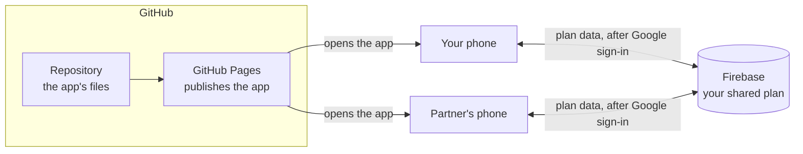

# How this app works (a guide for beginners)

This guide explains, in plain language, how the moving planner is built, where your data lives, and how changes reach your phone. You don't need any programming background.

## The big picture

The app has four parts. Each one does one job:

| Part | What it is | Everyday comparison |
|---|---|---|
| **The app's files** (`index.html`, `app.js`, …) | The instructions your browser follows to draw the app | A recipe |
| **GitHub** | A website that stores the files and remembers every change ever made | A shared folder with full history |
| **GitHub Pages** | A free GitHub service that puts those files on the internet at https://shigenaru.github.io/move-planner/ | A printer that publishes the latest recipe |
| **Firebase** | A free Google service that stores *your plan* (ticked steps, notes, budget) and keeps both phones in sync | A shared notebook in the cloud |

The **app** (the recipe) and **your data** (the notebook) are kept in different places. That's why the app's code can be public on GitHub while your plan stays private.

## Key words

- **Repository (repo):** the project folder on GitHub. Yours is `Shigenaru/move-planner`.
- **Commit:** one saved change, like a save point in a game. Each commit has a short message saying what changed.
- **Branch:** a separate copy of the files for trying a change without touching the live version. The live version is the `main` branch.
- **Pull request (PR):** a request to copy a branch's changes into `main`. It shows exactly what changed, so someone can review it before saying "yes" (**merge**).
- **Merge:** accepting a PR. The changes become part of `main`.
- **Deploy:** putting a new version online. Here, GitHub Pages deploys automatically about a minute after `main` changes.
- **Public repo:** anyone can *read* the code. Only you (and the tools you allow, like Devin) can *change* it. The plan data is not in the repo.
- **Firebase Authentication:** the "Sign in with Google" part. It tells the app who you are.
- **Firestore:** the Firebase database where the plan is saved.
- **Security rules:** a short list in the Firebase console that says who may read and write the plan. Yours allows only your Google accounts.
- **API key (in `firebase-config.js`):** an address label that tells the app *which* Firebase project to talk to. It is not a password; the security rules are what keep the data private.

## Where your data lives

1. **On each phone (the browser's storage):** the app keeps a copy so it opens fast and works briefly offline.
2. **In Firebase (the cloud):** after you sign in, every change is sent to Firebase, and Firebase pushes it to the other phone within about a second.

If you both edit at the same time, the app compares the two versions item by item and keeps the **newest change for each item**. For example, if you tick "Pack" while your partner edits the shopping list, both changes are kept.

Signing out removes the copy from that phone. The plan stays in Firebase, and signing in brings it back.

## Who can see what

| Thing | Who can see it |
|---|---|
| The app's code on GitHub | Anyone (it contains no personal data) |
| The app page itself | Anyone with the link, but it only shows a sign-in screen |
| Your plan (steps, notes, budget, addresses) | Only the Google accounts listed in the Firebase security rules |

To give someone else access, add their Gmail address to the security rules in the Firebase console (Firestore Database → Rules).

## Costs

Both GitHub Pages and Firebase are free for a project this size. Firebase's free tier allows tens of thousands of reads and writes per day; two people planning a move use a tiny fraction of that.

## What happens when the app is changed

See [Making changes safely](making-changes.md).
