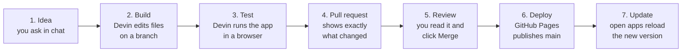

# Making changes safely (the software development life cycle)

The **software development life cycle (SDLC)** is the usual path a change takes, from idea to your phone. Here is that path for this app, with who does what.

## Step by step

1. **Idea.** You describe what you want in the Devin chat.
2. **Build.** Devin makes the change on a new **branch**, so the live app isn't affected yet.
3. **Test.** Devin opens the app in a browser on its own machine, clicks through the changed screens, and checks for errors.
4. **Pull request.** Devin opens a PR on GitHub. The **Files changed** tab shows every line that was added (green) or removed (red).
5. **Review.** You look at the PR. You don't need to understand every line; reading the description and checking that it matches what you asked for is a good review. When you're happy, click **Merge pull request**.
6. **Deploy.** About a minute after the merge, GitHub Pages publishes the new version.
7. **Update.** The app checks `version.txt` whenever you open it. When the number changes, it reloads itself so you see the new version. (Each change runs `./bump-version.sh`, which updates that number. Without it, phones could show the old version for up to 10 minutes because of browser caching.)

## How to review and merge a PR

1. Open the PR link Devin sends you (or the **Pull requests** tab of the repo).
2. Read the **description** at the top.
3. Optional: open the **Files changed** tab to see the exact edits.
4. If something is wrong, write a comment or tell Devin in the chat.
5. If it looks good, click **Merge pull request**, then **Confirm merge**.

## If something goes wrong

Every merged change is saved in GitHub's history, so any change can be undone. Ask Devin to "revert" the PR, and the previous version comes back.
